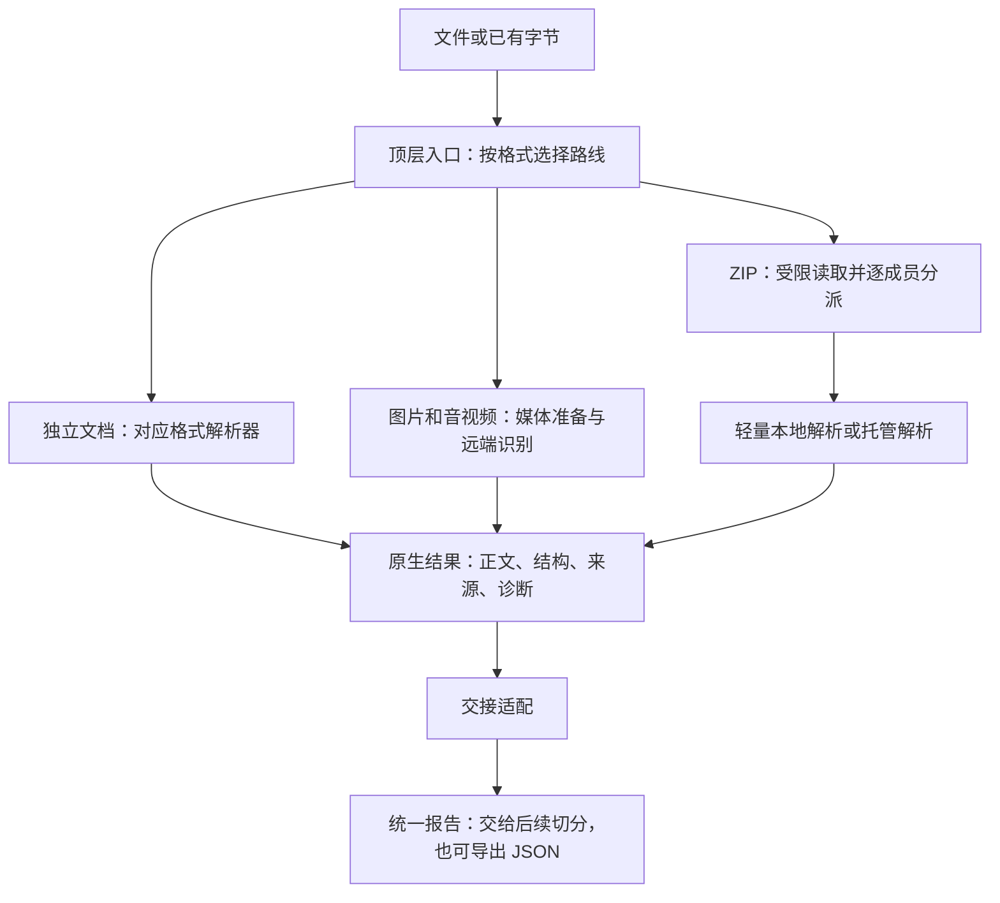

# 文档接入与解析：面试口述与实现说明

准备面试时，先假设对方只看过你的简历，完全不知道这个项目。你需要让他听懂：**文件进来以后做了什么，为什么要这么做，遇到问题又怎么处理。** 下面的介绍按当前项目实际做到的内容来写。

准备面试时，先练熟第 1 节的整体介绍，再按第 3 节补齐被追问的格式，最后用第 5 节脱稿自测。源码链接用于核对细节，不需要背目录名和函数名。

想练现场怎么接话，可以看单独的[本模块面试对话](INTERVIEW.md)。里面有 16 组问答和 3 道场景题，回答会把原理和例子讲完整，听的人不用先了解项目。

## 1. 面试时，先把整体讲清楚

### 约 30 秒的开场

> 我做的是把各种文件里的内容读出来，整理好，再交给后面的 RAG 处理。比如 PDF 要分文字页和扫描页，Excel 要读清楚数值属于哪一列，视频要记住这段内容出现在什么时间。最后除了正文，还会带上这些对应关系和来源，方便后面理解和核对。

### 约 2 分钟的完整介绍

> 我这块主要处理文件读进来的这一步。资料可能是 PDF、Word、Excel，也可能是一张图、一段视频，或者整个 ZIP 包。它们读起来不一样，读出来以后也不能只留一大段文字。比如表格里有个 500，至少要知道它是住宿上限还是交通费、单位是什么，否则后面很容易理解错。
>
> 所以首先按格式选择处理方式。比如直接传进来的 PDF，先看哪些页能直接提文字，需要识字的页再交给远端。Word、Excel、PPT 用对应的解析工具读；图片和视频的识别计算则交给已有的远端接口。
>
> 读的时候会把对应关系一起留下来。比如金额带着列名和适用条件，PDF 的识别结果要放回原来的页，视频里的内容要能找到对应时间。这些信息原来没给到，就说明目前不知道，不能自己补一个位置。
>
> ZIP 会再多一层处理，因为它里面是多份资料。每份分别记录结果，一份坏了，其他成功的还保留，同时告诉调用方这个包只完成了一部分。ZIP 这条路线还考虑了低配置服务器，里面较重的文档默认交给托管服务处理。
>
> 最后把结果整理成一种后面都能读取的表示，里面有正文、结构、来源和处理情况。这部分做到这里，后面再继续切分、向量化和检索。另外，接口返回成功也不代表内容一定读对了，像图片里的关键数字、复杂图示关系，还是需要对照原资料检查。

### 回答时抓住四个词

**选路线 → 取内容 → 留关系 → 做交接。**

只被问“这个模块做什么”，讲开场即可；被问“怎么做的”，再展开对应格式。重点放在处理问题和取舍上，不必一口气报完所有第三方库。

## 2. 一份资料从输入到输出，经过什么



入口和路线选择见[顶层实现](__init__.py)，纯交接见[交接分派](unifiedDocumentHandoff/dispatch.py)。顶层负责把流程串起来，交接适配只处理已经取得的结果，不重新解析或调用模型。

### 格式路线速查

下面区分“直接传入的独立文件”和“ZIP 内的成员”。**同一个扩展名，在这两种入口下可能采用不同路线。**

| 格式 | 独立文件的默认路线 | ZIP 内的默认路线 | 重点保留什么 |
| --- | --- | --- | --- |
| TXT、MD/Markdown | 本地解码与正文处理 | 本地处理 | 正文、编码、来源 |
| HTML/HTM | 本地提取正文或整页转换 | MinerU 托管解析 | 正文及实际取得的结构、来源 |
| MHTML/MHT | 本地选择主 HTML 部分后转换 | 本地选择主 HTML 部分后交给 MinerU | 实际选中的归档部分 |
| PDF | 本地文本层提取；需要 OCR 的页走 MinerU | 包括数字 PDF 在内，默认走 MinerU | 实际 PDF 页序、提取方式 |
| DOCX | python-docx 本地解析 | MinerU 托管解析 | 本地可取得章节、正文块；托管结果保留实际服务粒度 |
| CSV | 本地 CSV 解析 | 本地处理 | 字段原文、完整列名、共同上下文、记录位置 |
| XLSX | openpyxl 本地解析 | MinerU 托管解析 | 本地可取得行列、单元格、公式及缓存；托管结果不冒充这些位置 |
| PPTX | python-pptx 本地解析 | MinerU 托管解析 | 本地可取得演示页、对象和备注；托管结果保留实际服务粒度 |
| JSON、XML | 本地结构化解析 | 本地处理 | 完整表示、节点路径、父子关系 |
| PNG、JPG/JPEG、WebP | Pillow 校验图片，阶跃 API 执行所选任务 | 沿用图片处理 | 任务、图片版本、派生文字、原图映射 |
| WAV、MP3、M4A、OGG、FLAC、MP4、MOV、MKV | FFmpeg/FFprobe 准备媒体，阶跃 API 识别 | 沿用媒体处理 | 语音／画面归属、实际片段时间、原媒体版本 |
| ZIP | 容器管理和逐成员分派 | 不递归展开内嵌 ZIP | 成员清单、独立结果、整包状态 |

ZIP 路线由[分派实现](8_zipContainers/dispatch.py)和 [ADR 0001](../../../docs/adr/0001-zip-api-first-parsing.md)确定。不要把 ZIP 的托管策略扩大成“项目中所有文档都走远端”。

## 3. 各种格式，被追问时怎么说

### 3.1 TXT、Markdown：先把字节正确读成文字

可以这样说：

> 这类文件的结构相对简单，首先要处理的是编码。实现里优先尊重调用方明确指定的编码，其次看 BOM 和适用的格式声明，再尝试 UTF-8，必要时才做编码探测。探测结果会给出提示，已知编码解不出来就直接报告失败。Markdown 则尽量保留已有标题、列表和代码空白，给下游完整正文。

追问时展开：显式编码优先于 BOM；BOM 优先于格式内声明；纯 TXT 没有 HTML 那样的编码声明。解码成功只说明拿到了文字，不证明自动探测一定判断正确。

源码证据：[共享解码与 Markdown 处理](text_support.py)。

### 3.2 HTML、MHTML：区分正文与页面附属内容

可以这样说：

> 网页里除了文章，还有导航、广告和页脚。独立 HTML 可以选择提取正文，也可以做整页转换；两种模式都会去掉脚本和样式。MHTML 是网页归档，里面可能有多个 HTML 部分，所以要先选出本次使用的主 HTML，并把选中的来源记下来，再进行转换。

具体实现采用 BeautifulSoup 处理结构、markdownify 转 Markdown。正文提取按已有标签和页面标记做启发式选择，不能承诺适用于所有网站。MHTML 优先采用明确的主部分标识；没有标识时按**解码后的 HTML 字符数**选择，并保留警告。

当前入口处理已有静态内容，不抓取网页、不执行 JavaScript，也不自动识别网页内嵌图片。ZIP 内的 HTML 走托管路线，MHTML 只在本地完成主部分选择后提交。

源码证据：[HTML 转换](2_textAndWebContent/html_conversion.py)、[MHTML 主部分选择](2_textAndWebContent/mhtml.py)。

### 3.3 PDF：数字页和扫描页分开处理，再回到原页序

可以这样说：

> 独立 PDF 会先逐页读取文本层。没有可用文字、但包含图片的页，会进入 OCR 路线；调用方也能明确指定哪些页需要重新识字。混合 PDF 只把这些页组成一份 PDF 交给 MinerU，拿到结果后再映射回原始页序，和本地提取的其他页合并。这样能保留每页实际用了什么提取方式。

一个适合面试讲的例子：原文共 4 页，第 2、4 页需要 OCR。上传资料中的第 1、2 页实际对应原文第 2、4 页，结果必须映射回去，不能直接把远端序号当成原始页序。

还要补一句：**文本层非空不代表正文完整。** 扫描正文可能只提取到一个页码，此时需要对照原页，并可用 `ocr_pages=(2,)` 指定原始第 2 页识字。当前本地提取也没有保证恢复多栏、复杂表格和全部阅读顺序。pypdf 官方同样区分[文本提取与 OCR](https://pypdf.readthedocs.io/en/stable/user/extract-text.html#ocr-vs-text-extraction)。

源码证据：[逐页提取与合并](pdfAndDocxExtraction/pdf.py)、[MinerU 上传与结果轮询](mineru_client.py)及 [PDF 专属 OCR 解释](pdfAndDocxExtraction/mineru.py)。PDF 页序指文件中的实际顺序，和纸面印刷页码分别解释。

### 3.4 Word：保留段落、表格与章节归属

可以这样说：

> 独立 DOCX 通过 python-docx，按正文里的段落和表格顺序读取。标题会建立章节路径，每个正文块记录它属于哪个章节、在正文中的顺序，以及对应输出正文的哪个区间。这样下游拿到一条规定时，还能知道它原来属于哪一节。

当前覆盖正文段落和普通矩形表格；图片、文本框、页眉页脚以及复杂合并或嵌套表格布局不保证恢复。正文块号能说明内容顺序，不能当成 Word 页码。旧二进制 DOC 格式没有列入当前支持范围。

源码证据：[DOCX 正文顺序与章节来源](pdfAndDocxExtraction/docx.py)。

### 3.5 CSV：值要带着列名和条件一起交接

可以这样说：

> CSV 按真实的字段和记录解析，不是直接按逗号拆字符串，因为引号里可能有逗号和换行。读取时会保留字段文本、前导零和原始记录位置。后面可以输出整表，也可以输出带完整列名和共同上下文的按行表示。

例如一行是“武汉，500”，单独交出去含义不完整。按行表示需要能说明“城市：武汉；住宿上限：500 元”，并保留调用方提供的适用对象、版本等共同上下文。这个例子用于说明设计，具体条件仍来自输入或显式配置，不自动猜补。

源码证据：[CSV 解析](4_tabularFileProcessing/csv_content.py)、[表格与按行表示](4_tabularFileProcessing/rendering.py)。

### 3.6 Excel：表头、合并关系和公式要分别处理

可以这样说：

> 独立 XLSX 用 openpyxl 读取，重点是保留表头和单元格之间的真实对应关系。多层表头根据已有合并关系形成完整列名，普通空白不会自动填成上一格的值。公式方面会分别读取公式视图和缓存视图，把公式表达式、文件缓存和显示文字分开保存，本地不执行公式重算。

公式缓存可能缺失，也可能过时。比如单元格有公式但没有缓存，输出会明确表示结果未知；不能为了让表格看起来完整就填零。合并区域中被覆盖的格子，也不能冒充这一行独立填写的值。

这项取舍意味着可以保存和解释文件已有结果，但不能声称实现了 Excel 计算引擎。[openpyxl 官方教程](https://openpyxl.readthedocs.io/en/stable/tutorial.html#loading-from-a-file)说明了公式与已有值视图的区别。

源码证据：[工作簿双视图及表头读取](4_tabularFileProcessing/xlsx_content.py)、[公式与缓存表示](4_tabularFileProcessing/xlsx_values.py)。当前独立表格支持 CSV、XLSX，未接入旧 XLS。

### 3.7 PPT：先保留演示页归属，再说明阅读顺序的限制

可以这样说：

> 独立 PPTX 会按原始幻灯片逐页提取标题、文本对象、表格和演讲者备注，同时保留对象路径和位置。这样不同页的条件和结论不会混在一起。但文件里的对象图层顺序，不能直接认定为人的阅读顺序，所以复杂分栏、箭头和图文关系会留下待核验事项。

本地 PPTX 路线使用 python-pptx，没有自动把每张幻灯片渲染后交给视觉模型。图片对象可以留下来源和待核验信息，但不能说已经完成图片 OCR。旧 PPT 格式没有接入。

源码证据：[演示页、对象与备注提取](5_presentationsAndStructuredDocuments/pptx_content.py)。

### 3.8 JSON、XML：保留树形关系，路径不冒充正文偏移

可以这样说：

> 结构化文档既要保留完整内容，也要保留节点属于哪个父节点。JSON 用 JSON Pointer 定位节点，保留值类型和数组顺序；XML 则记录命名空间展开名称、同名元素序号和父路径。下游可以沿着这些关系理解内容，不需要从一大段字符串里猜节点归属。

例如 JSON 的 `/rules/0/condition` 定位第一条规则的条件。它是结构位置，不是正文中的第几个字符；对象字段的排列也不能直接当成业务执行顺序。JSON Pointer 的语法依据是 [RFC 6901](https://www.rfc-editor.org/rfc/rfc6901)。

本项目的 XML 节点路径是自定义的可区分位置表示，不是完整 XPath；XML 正文保留解码后的原文表示，不通过重新序列化猜造字符映射。顶层 JSON 路由选择的是带节点来源的结构化入口。

源码证据：[JSON/XML 解析与节点来源](5_presentationsAndStructuredDocuments/structured.py)。

### 3.9 图片：识字、描述和按问题理解是三种任务

可以这样说：

> 图片由调用方明确选择 OCR、图像描述，或者针对问题做视觉理解。模型计算使用阶跃 API，本地先检查图片是否可解码、格式是否匹配，并保留尺寸和原始字节摘要。返回时把派生文字、任务、模型及提示词版本、来源和待核验信息放在一起，方便之后核查。

三种任务分别回答“图上写了什么”“画面主要是什么”“针对这个问题，图里的关系是什么”。视觉理解使用本次图片和问题，不拿已有 OCR 文字当成已经看过原图。

结构化响应能帮助检查输出形状，但不保证识别事实正确。正常无文字、无法确认和调用失败保持不同状态；裁剪图可以携带原图映射，但模块不负责永久保存原图。

源码证据：[图片入口与响应处理](6_imageProcessing/__init__.py)、[任务提示与响应约束](6_imageProcessing/prompts.py)、[原图映射](6_imageProcessing/provenance.py)。

### 3.10 音视频：语音和画面分开识别，定位到实际片段

可以这样说：

> 音视频先用 FFprobe 了解媒体流和时长，再用 FFmpeg 做必要准备。语音转写会准备音频片段，视频理解会准备画面片段，之后调用对应的阶跃 API。调用方可以选择只转写、只看画面或者两者都做。结果保留每段实际起止时间，并区分语音内容和画面解释。

需要能回答的三个细节：

- 音频准备为单声道、16 kHz 的 PCM WAV；视频片段采用码流复制，受原编码和关键帧影响，不保证恰好按设定秒数切开。
- 片段时间来自实际准备结果，并处理原音轨或画面延迟起始的情况；不能直接用“片段序号 × 目标时长”猜测。
- 当前逐片串行处理；时间定位是片段级，未取得逐词时间和说话人区分时保持未知。模型计算在远端，本机没有部署 ASR 或视觉模型。

源码证据：[媒体探测与切片](audioTranscriptionAndVideoUnderstanding/media.py)、[任务编排](audioTranscriptionAndVideoUnderstanding/__init__.py)、[完成片段的纯结果组装](audioTranscriptionAndVideoUnderstanding/assembly.py)。

### 3.11 ZIP：处理一组独立资料，明确哪些完成了

可以这样说：

> ZIP 在这里是一份资料集合。实现会逐成员读取、按成员格式分派，并分别保留来源和处理结果。一个成员失败时，其他已经成功的资料仍然保留，整包标记为部分成功。相同路径的重复条目也通过原始条目序号区分，避免结果混淆。

容器已有压缩输入大小、成员数量、单成员和累计展开量限制，并在处理过程中检查协作式截止。它不按成员原路径解压到磁盘，也不递归处理内嵌 ZIP。截止检查不能强制打断一个已经运行的解析器或外部请求，不能描述成严格的进程级超时。

对低配置服务器，ZIP 内 PDF、DOCX、PPTX、XLSX、HTML/MHTML 默认用托管解析；TXT、Markdown、JSON、XML、CSV 仍做轻量本地处理。托管配置缺失或调用失败会明确报告，当前没有自动回退到本地重解析。

源码证据：[成员处理与失败隔离](8_zipContainers/__init__.py)、[容器预算说明](8_zipContainers/README.md)、[托管文档处理](hosted_documents.py)。

## 4. 最值得讲清楚的设计取舍

### 4.1 为什么不能只返回一大段文字

可以这样说：

> 因为后续问答依赖的通常是关系。比如“500 元”要知道限制的是住宿还是交通，“负责人审批”要知道适用哪个金额条件。我会把正文和已有结构、来源一起交接，避免下游只看见结论、看不见条件。后面把块调大，也恢复不了解析阶段已经丢失的关系。

统一结果的主要内容见[结果模型](unifiedDocumentHandoff/models.py)：

| 内容 | 口语解释 |
| --- | --- |
| body、body_format | 完整正文，以及该按 Markdown 还是普通文字解释 |
| units | 交给后续处理的内容单位，例如表格行或媒体片段；还没有完成最终检索切分 |
| sources | 这段内容来自哪里，能回查到什么粒度 |
| structure | 表格、节点、正文块或媒体片段之间已有的结构 |
| diagnostics、requires_review | 哪里处理失败、哪里存在警告、哪里仍待核验 |
| business_id、version | 调用方已知的业务身份与版本，未知就保持空 |

单次报告中会分配内部引用 ID，它们不承诺跨次稳定。图片或媒体的字节摘要用于区分原始字节版本，也不能直接当成业务版本。

### 4.2 统一表示，会不会损失不同格式的特点

可以这样说：

> 统一的是下游读取结果的方式，保留的位置粒度仍然由实际解析结果决定。有的文档能精确对应正文区间，有的只有表格行、节点路径、服务块或者媒体时间。没有精确对应关系时就说明限制，不把这些位置硬换成字符偏移。

已有正文映射时，区间采用 Python 字符的左闭右开范围，可用正文切片验证。节点路径、原始文件字节位置和媒体秒数都各有含义。PDF 的实际页序、DOCX 的正文块号、托管 Office 的服务位置，也要分别解释。

### 4.3 为什么同时保留本地解析和托管解析

可以这样说：

> 路线取决于任务和部署约束。独立格式入口保留已有本地解析，可以取得一些原生结构。ZIP 集成面向低配置服务器，所以把较重的文档解析交给已有托管服务。这样减少了本机的重处理负担，代价是网络、费用、可用性和服务结果粒度的限制。

没有做性能测量时，只说明设计目的和已知代价。当前不能据此给出吞吐提升倍数或识别准确率；API 成功也不说明原生单元格或对象坐标已经恢复。

### 4.4 这次顶层入口优化了什么

可以这样说：

> 原来调用方要先选择具体解析模块，拿到不同的原生结果，再自己调用交接入口。这次把格式选择、解析和交接集中到了顶层。常见调用只需要提供文件或字节，复杂的格式选项继续交给已有解析器处理。这样以后调整流程时，调用方需要了解和修改的内容更少。

文件入口直接使用对应解析器的文件入口，保留媒体和 ZIP 原有的文件处理方式；没有在顶层把每种文件都额外整份读进内存。当前复用了已有实现，没有新增可动态注册的插件体系。

### 4.5 怎么证明它工作正常

可以这样说：

> 测试会用固定文件经过真实解析和公开交接入口，检查关键文字、结构归属、来源与处理状态。涉及远端协议时，用本地 HTTP 服务验证实际请求和响应处理；识别内容质量则需要显式运行真实服务，并对照原始资料核验。两类证据分别记录。

可以举三个检查点：混合 PDF 的 OCR 结果是否回到原第 2、4 页；表格一行能否对应完整列名和共同上下文；ZIP 里一个成员失败后，其他结果和整包部分成功是否都保留下来。

入口验证见[顶层回归](../../../tests/test_document_ingestion.py)，更细的来源检查见[文档交接测试](../../../tests/test_handoff_documents.py)、[表格交接测试](../../../tests/test_handoff_tables.py)、[ZIP 交接测试](../../../tests/test_handoff_zip.py)。

## 5. 面试追问：先脱稿回答，再展开核对

练习时，每题先用 30～60 秒回答，再展开参考。能举一个具体例子，比背整段定义更有用。

<details>
<summary>1. 文档解析和文档切分有什么区别？</summary>

解析从输入中取得正文、结构和来源；切分把已经取得的内容组织成检索使用的内容块。当前交接内容单元可能是一行表格或一段媒体，但不等于已经完成检索切分。解析遗漏了条件，后续扩大块也不能恢复。

</details>

<details>
<summary>2. PDF 已经能复制出文字，为什么还可能需要 OCR？</summary>

非空文本层可能只有页码、页眉，或者来自之前识别质量有限的 OCR。当前自动判断只是启发式；对照原页发现问题后，可以明确指定原始页序重新识字。还要说明独立 PDF 与 ZIP 内 PDF 的默认路线不同。

</details>

<details>
<summary>3. 表格里提取出一个“500”，还缺什么？</summary>

缺少它属于什么对象、什么列、什么单位，以及适用哪些条件。例如要能说明它是武汉的住宿上限，并带上输入中已知的适用范围和来源。未知上下文保持未知，不能由解析层补造。

</details>

<details>
<summary>4. 为什么不能把 Excel 公式缓存当成实时计算结果？</summary>

缓存是文件中保存的已有结果，可能缺失或已经过时。实现保留公式与缓存两种视图，并明确标记未知值，不执行公式重算。能读取表格，不等于实现了 Excel 计算引擎。

</details>

<details>
<summary>5. ZIP 里十份资料，有两份失败，怎么交给下游？</summary>

保留成功资料的独立结果，同时保留失败成员和各自原因，整包报告部分成功。下游能使用成功内容，也能知道资料集合尚不完整。容器的业务身份不自动复制给每份成员文档。

</details>

<details>
<summary>6. 统一输出以后，能直接给所有内容做精确引用吗？</summary>

只能沿用实际取得的定位精度。已有正文区间可以切片核验；节点路径、服务块和媒体片段保留它们自己的粒度。没有 OCR 字框或逐词时间时，不能声称具备对应精度的高亮引用。

</details>

<details>
<summary>7. 模型返回了符合 JSON Schema 的结果，是否说明内容正确？</summary>

结构约束帮助验证字段和状态是否符合约定，事实是否正确仍需对照原图或原媒体。正常无文字、无法确认、技术失败和待核验各有含义，不能用“返回成功”替代内容质量结论。

</details>

<details>
<summary>8. 如果增加一种新格式，你会改哪里？</summary>

先确认现有解析器能否复用，再添加需要的格式实现与明确路由。如果产生新的原生结果类型，就补充相应交接适配；随后通过公开入口，用真实样本验证正文、结构、来源和失败行为。当前不需要先建立通用插件平台。

</details>

### 复习时的自测标准

- 不看材料，说出模块的输入、输出、所处 RAG 阶段。
- 随机选两种格式，各讲一个真正需要处理的难点。
- 用混合 PDF 或表格举例，说明“文字保留下来了，关系仍可能丢失”。
- 说清一项设计代价，以及一项尚未实现的能力。

第一次练开场；隔天换顺序讲 PDF、Excel 和 ZIP；几天后让同伴随机追问，或让助手模拟面试官。回答卡住时回到对应源码和例子核对，不把“看着很熟”当成已经能脱稿表达。

## 6. 实际调用与开发参考

[顶层公开入口](__init__.py)完成格式选择、原生解析和统一交接。调用方使用文件或字节入口，直接取得统一输出，不必选择子目录或处理中间结果类型。

```python
from importlib import import_module

ingestion = import_module("app.modules.1_documentIngestionAndParsing")

report = ingestion.convert_file(
    "manual.docx", business_id="manual", version="v2",
)
ingestion.export_json(report, "handoff.json")

report = ingestion.convert_bytes(
    '{"条件": "签收后7天内", "要求": "未拆封"}'.encode("utf-8"),
    format="json", source="售后政策.json",
)
for document in report.documents:
    print(document.body, document.units, document.sources, document.diagnostics)
```

### 公开入口

- [convert_file](__init__.py)：接受文件路径，以及可选的格式、来源、业务身份和格式专属选项。默认按文件扩展名选择格式，显式格式可覆盖扩展名；来源默认使用文件路径。
- [convert_bytes](__init__.py)：接受已有字节，格式与来源必须明确提供；同样支持业务身份和格式专属选项。
- [export_json](exports.py)：接受报告和写入位置，以 UTF-8 导出，返回写入位置；原有交接入口继续使用同一实现。

两个转换入口返回既有 [HandoffReport](unifiedDocumentHandoff/models.py)。完整正文、交接内容单元、结构、来源和诊断的含义见[统一交接约定](unifiedDocumentHandoff/README.md)。交接内容单元并非最终检索块。

业务标识与版本只接受非空白字符串或空值，先于文件读取和模型调用校验。ZIP 的业务标识与版本属于容器；成员文档保持各自身份未知，不继承容器身份。

### 格式选项与传递方式

格式忽略大小写、首尾空白和前导点。选项原样交给所选原生解析器，由它负责校验；顶层不建立第二份格式选项模型。

| 输入格式 | 使用的原生 Module | 常用选项 |
| --- | --- | --- |
| TXT、MD/Markdown、HTML/HTM、MHTML/MHT | [文本与网页](2_textAndWebContent/__init__.py) | encoding、mode |
| PDF、DOCX | [PDF 与 DOCX](pdfAndDocxExtraction/__init__.py) | mineru、ocr_pages |
| CSV、XLSX | [表格文件](4_tabularFileProcessing/__init__.py) | context、mode、encoding、delimiter、header_record、xlsx |
| PPTX、JSON、XML | [演示文稿与结构化文档](5_presentationsAndStructuredDocuments/__init__.py) | encoding（仅 JSON/XML） |
| PNG、JPG/JPEG、WebP | [图片](6_imageProcessing/__init__.py) | task、question、config、document、crop |
| WAV、MP3、M4A、OGG、FLAC、MP4、MOV、MKV | [音视频](audioTranscriptionAndVideoUnderstanding/__init__.py) | task、question、config、options |
| ZIP | [ZIP 容器](8_zipContainers/__init__.py) | limits、metadata_encoding、parser_options |

JSON 始终选择结构化解析，以保留节点路径和父子归属。图片与音视频仍须明确指定任务；媒体的 `options` 是其原有处理选项，ZIP 的 `parser_options` 保持原有按类别配置方式。

```python
report = ingestion.convert_bytes(
    "姓名;城市\n小明;武汉".encode("gb18030"),
    format="csv", source="名单.csv", delimiter=";", encoding="gb18030",
)
report = ingestion.convert_file("规则图.png", task="ocr")
report = ingestion.convert_file(
    "资料包.zip", parser_options={"image": {"task": "ocr"}},
)
```

独立格式沿用各自原有解析路线；ZIP 内的文档仍按照 [ADR 0001](../../../docs/adr/0001-zip-api-first-parsing.md)使用托管解析。图片、音视频继续使用既有远端模型。文件交给原生文件入口，不通过顶层整份读取后再转交字节入口；导入顶层包也不会提前导入全部解析器。

### 实现职责与兼容入口

新代码采用 `pdfAndDocxExtraction`、`audioTranscriptionAndVideoUnderstanding`、`unifiedDocumentHandoff`。旧 `3_pdfAndWordParsing`、`7_audioAndVideoProcessing`、`9_unifiedOutputAndChunkingHandoff` 及其已有子模块只做兼容转发，共用函数、模型和配置；旧媒体命令仍可运行，不增加弃用警告。

共享能力按职责放置：[exports.py](exports.py)提供 JSON 与 Markdown 导出，[identity.py](identity.py)校验业务身份，[text_support.py](text_support.py)处理解码、严格 JSON 与 Markdown 共性，[format_routes.py](format_routes.py)分别记录独立输入与 ZIP 成员路线。[mineru_client.py](mineru_client.py)负责通用传输；PDF 的选页、OCR 解释与原页序映射仍由 PDF/DOCX 包负责。[stepfun_support.py](stepfun_support.py)仅共享配置与完成响应信封检查，图片和媒体保留各自任务、类型及默认超时。

托管文档的[编排](hosted_documents.py)调用[输入准备](hosted_document_input.py)、共享客户端和[产物读取](hosted_document_artifacts.py)，交接包中的[托管适配](unifiedDocumentHandoff/hosted_documents.py)只转换已有结果。媒体探测、切片、请求和临时文件清理由媒体编排负责；[纯组装](audioTranscriptionAndVideoUnderstanding/assembly.py)只处理已完成片段的正文、状态、警告与待核验信息。交接分派按真实原生类型选择适配器，避免提前初始化无关解析依赖。

### 失败与验证

顶层无法选择格式时抛出 ValueError；不合法的路径类型、业务身份或未知关键字选项按其 TypeError／ValueError 传播。已选格式的文件读取、内容、来源和解析选项错误遵循原生结果约定，通过报告的状态与诊断返回。解析器内部未处理的异常不由顶层统一吞掉。

报告保留 `success`、图片／媒体的 `content`、`no_text`、`uncertain`，以及 ZIP 的 `partial_success`、`failed` 等原有状态。技术完成与待核验状态独立；失败或部分成功报告均可导出。

```shell
python -m unittest tests.test_document_ingestion -v
python -m unittest discover -s tests -q
```

[入口回归](../../../tests/test_document_ingestion.py)通过真实固定文件、本地 HTTP 协议服务和现有媒体准备，检查格式选择、文件／字节结果一致性、原生结构与来源保留、错误及 ZIP 托管路线。

### 运行条件与当前范围

依赖按项目现有的 [requirements.txt](../../../requirements.txt) 安装，媒体处理需要可用的 FFmpeg/FFprobe。远端处理使用运行时配置；名称与示例见[环境配置示例](../../../.env.example)，核心库不会自行搜索或加载环境文件。

当前实现止于接入、解析和交接，没有在此完成实际切块、embedding、向量索引、召回或完整问答。也没有加入统一上传端点、任务队列、自动重试平台和原始资料持久化。后续模块若需要回查原文，调用方仍要保存相同版本的原始资料。

### 推荐阅读顺序

1. 先读[项目术语表](../../../GLOSSARY.md)，统一“来源信息”“交接内容单元”“片段级时间定位”等概念。
2. 对 PDF 重点读 [pypdf 官方文本提取说明](https://pypdf.readthedocs.io/en/stable/user/extract-text.html)，理解为什么有文字也不等于恢复了版式关系。
3. 对 Excel 重点读 [openpyxl 官方加载说明](https://openpyxl.readthedocs.io/en/stable/tutorial.html#loading-from-a-file)，再对照本项目的公式与缓存实现。
4. 对结构化文档读 [RFC 6901](https://www.rfc-editor.org/rfc/rfc6901)，理解 JSON Pointer 表示的节点位置与字符偏移的区别。

如果某一段只能照读，可以继续让助手针对这一段提问，并检查你的复述是否遗漏条件、来源或实现限制。
